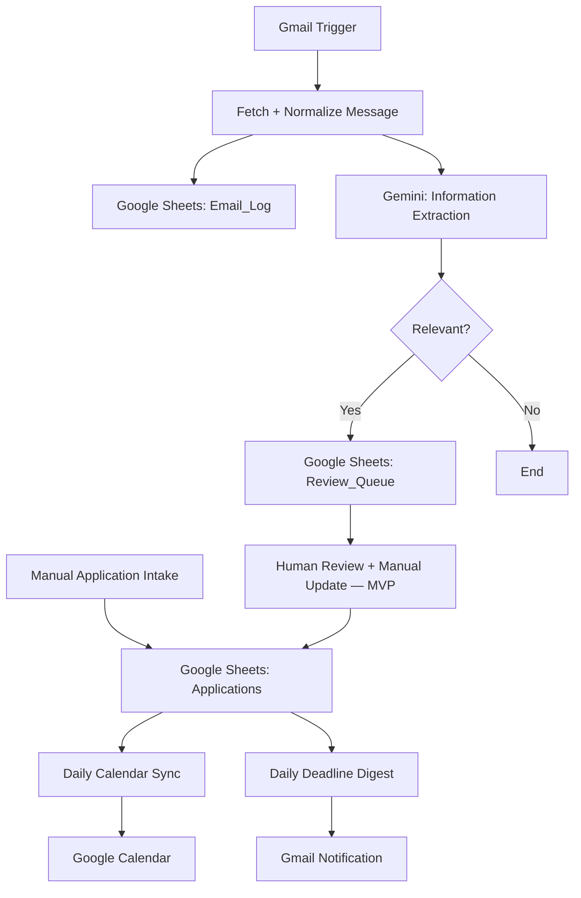
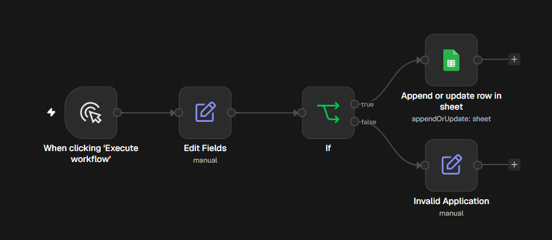
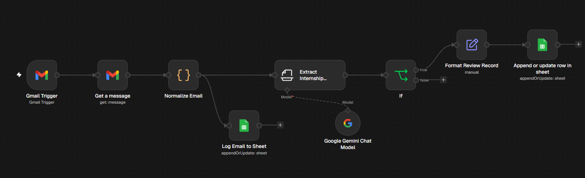
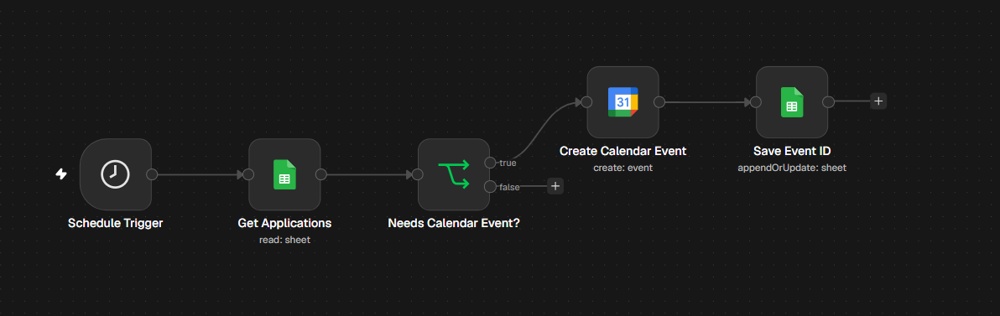
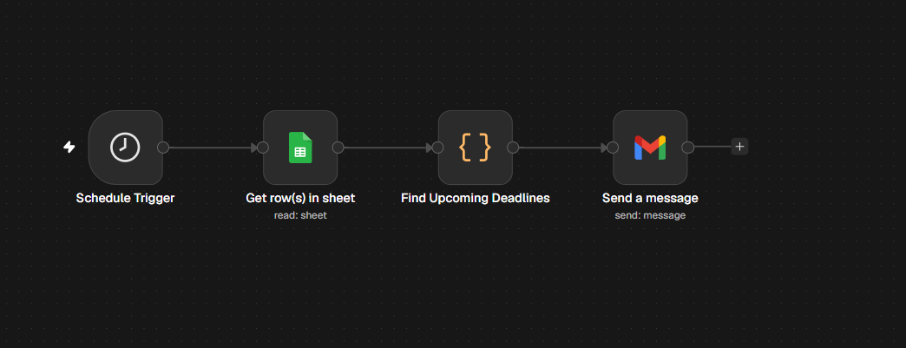

# Internship Intelligence — AI-Powered Recruitment Workflow Automation

> **Project status:** MVP workflows built locally; verify each scheduled workflow before claiming 24/7 operation. Public repository contains no personal correspondence or credentials.

## Overview
Internship Intelligence is an n8n-based system designed to reduce repetitive internship application tracking. It integrates Gmail, Google Gemini, Google Sheets, Google Calendar, and JavaScript transformations to organize application correspondence and help track deadlines.

## Problem
Internship communications arrive across multiple emails. Manually tracking stages, deadlines, and follow-up tasks is time-consuming and can lead to missed actions.

## Solution & architecture

**Important:** Approved review records are *not* automatically transferred to the Applications sheet in the current MVP. This requires manual review and update until an approval-sync workflow is implemented.

## Milestones / Workflows

| Workflow | Purpose | Implementation |
|---|---|---|
| 01 — Application Intake | Validate and upsert application records | Manual Trigger → Edit Fields → IF → Google Sheets / invalid branch |
| 02 — Gmail Intake & AI Extraction | Log and classify recruitment emails, extract structured fields and queue for review | Gmail Trigger → Get Message → JavaScript normalization → Google Sheets Email_Log + Gemini Information Extractor → IF → Review_Queue |
| 03 — Calendar Sync | Create calendar events for verified deadlines and store event IDs | Schedule Trigger → Google Sheets → IF → Google Calendar → Google Sheets |
| 04 — Deadline Digest | Email a summary of deadlines within the next three days | Schedule Trigger → Google Sheets → JavaScript date checks and aggregation → Gmail |

## Technology
- **Orchestration:** n8n (self-hosted Community Edition)
- **AI extraction:** Google Gemini Chat Model via n8n Information Extractor
- **Integrations:** Gmail API, Google Sheets API, Google Calendar API
- **Data transformations:** JavaScript (n8n Code nodes)
- **Storage:** Google Sheets (Applications, Email_Log, Review_Queue)
- **Runtime:** Docker

## Data model
- **Applications:** `application_id`, `company`, `position`, `source`, `status`, `date_applied`, `deadline`, `next_action`, `notes`, `calendar_event_id`
- **Email_Log:** `email_id`, `sender`, `subject`, `snippet`, `body_source`, `detected_at`, `review_status`
- **Review_Queue:** `email_id`, `company`, `position`, `stage`, `deadline`, `next_action`, `review_status`, `application_id`

## Setup (local)
1. Install Docker Desktop.
2. Create the named volume once: `docker volume create n8n_data` (skip if it already exists).
3. If an existing container named `n8n` is running, stop it before using Compose: `docker stop n8n`. **This repository's `compose.local.yaml` intentionally mounts the existing `n8n_data` volume.**
4. Start: `docker compose -f compose.local.yaml up -d`.
5. Open `http://localhost:5678`.
6. Import each sanitized workflow from `workflows/` using the n8n workflow menu → Import from File. Reconnect Google and Gemini credentials in your own instance.
7. Configure your own spreadsheet IDs, account permissions, and scheduling timezone (`Asia/Jakarta`).
8. Run the tests described in [`docs/testing.md`](docs/testing.md) before activating scheduled workflows.

**Do not commit any API keys, OAuth client secrets, complete email bodies, real application IDs, or personal email addresses.** Workflow JSON exports should be manually reviewed and sanitized before committing.

## Deployment options
- **Local Docker (current):** free hosting on your computer. Automations run only while the computer and n8n are running. Closing Google Sheets does not interrupt API writes.
- **n8n Cloud:** managed paid hosting, easier for 24/7 running. Import workflows and reconnect credentials.
- **VPS + Docker Compose:** 24/7 self-hosted operation with persistent storage, HTTPS reverse proxy, backups, access control, and monitoring. Requires server administration.

The included Compose file is intended for **local-only** use and binds to `127.0.0.1`. Do not expose it directly to the public internet.

## Workflow Architecture

### 1. Application Intake & Validation

### 2. Gmail Integration & AI Extraction

### 3. Google Calendar Synchronization

### 4. Automated Deadline Notifications

## Testing & limitations
See [`docs/testing.md`](docs/testing.md) for a reproducible test plan and [`docs/architecture.md`](docs/architecture.md) for technical decisions and improvements.

Current limitations:
- Email trigger coverage depends on Gmail search filters.
- AI output requires human review; ambiguous dates must not be accepted automatically.
- Review Queue and Applications are not automatically synchronized in the MVP.
- One `calendar_event_id` per application supports only one tracked event per application and does not handle changed deadlines yet.
- Local Docker instance and scheduled triggers require the computer to be running.
- Google OAuth authorization may require reconfiguration when changing hosts.

## Future work
- Approved-record synchronization to Applications with application matching.
- A normalized `Deadlines` table supporting multiple assessments/interviews per application.
- Status history for true funnel analytics and response-time measurements.
- Error alerting, retry policies, regression tests, and operational monitoring.
- A BI dashboard built on verified application data.

## License / usage
This repository documents a personal learning project. Refer to n8n's Sustainable Use License for applicable n8n usage terms.
