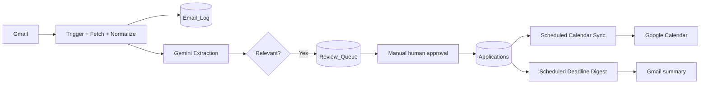

# Architecture and design decisions

## Logical architecture

## Integration boundaries
- Gmail API: source messages; filtered by the trigger's Gmail query.
- JavaScript Code node: parse and normalize selected fields for downstream nodes.
- Gemini Information Extractor: structured classification of message content; model suggestions are untrusted until reviewed.
- Google Sheets API: lightweight storage and upsert logic using `email_id` and `application_id`.
- Google Calendar API: create one event for an approved application deadline and persist the event ID.
- Schedule Trigger: run periodic checks when the n8n process is active.

## Idempotency and integrity
- Use `email_id` as the stable key for Email_Log and Review_Queue.
- Use `application_id` as the stable key for Applications.
- Persist `calendar_event_id` to skip existing events on later sync runs.
- In the current MVP, changing a deadline does not automatically update an existing Calendar event.
- A future `Deadlines` tab should use a unique `deadline_id` to support multiple events for one application.

## Data privacy
- Use fake examples in source control.
- Do not publish real email bodies, credential IDs/names, tokens, sheet IDs, personal addresses or raw execution logs.
- Limit Gmail trigger filters to relevant emails when possible.
- Manually review AI-extracted information before taking external actions.

## Reliability
- Persistence: use named Docker volume `n8n_data`.
- Runtime: a laptop-hosted Docker engine only runs while the laptop stays awake and the container is up.
- Deploying to a VPS requires HTTPS, access controls, monitoring, credential updates and backups.
- Tests are documented separately in `testing.md`.
